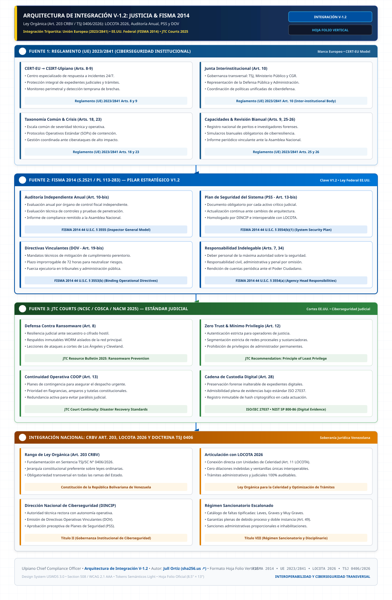
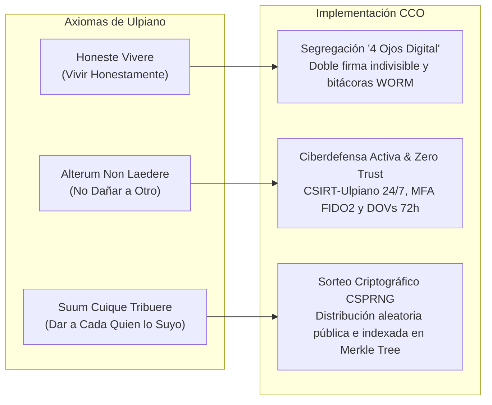
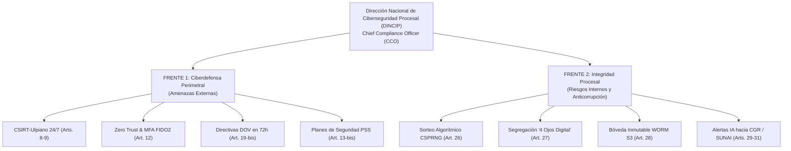

# ⚖️ Ulpiano — Chief Compliance Officer (CCO)
### *Arquitectura de Ciberseguridad Procesal, Integridad Digital y Forense Judicial (V-1.2)*

<p align="center">
  
</p>

<p align="center">
  <a href="LICENSE"></a>
  
  
  
  
  
  
</p>

---

## 📑 Tabla de Contenidos

1. [🎯 1. La Idea Central (¿Qué es Ulpiano CCO?)](#-1-la-idea-central-qué-es-ulpiano-cco)
2. [⚠️ 2. El Problema (Diagnóstico y Pain Points)](#️-2-el-problema-diagnóstico-y-pain-points)
3. [💡 3. La Solución: Tesis del Doble Frente](#-3-la-solución-tesis-del-doble-frente)
4. [⚙️ 4. ¿Cómo Funciona? (Guía Técnica Paso a Paso)](#️-4-cómo-funciona-guía-técnica-paso-a-paso)
5. [🏛️ 5. Los 4 Grandes Bloques Arquitectónicos](#️-5-los-4-grandes-bloques-arquitectónicos)
6. [🧭 6. El Portal Web Oficial (Arquitectura MPA Astro 7)](#-6-el-portal-web-oficial-arquitectura-mpa-astro-7)
7. [🖼️ 7. Suite de 12 Perspectivas Vectoriales](#️-7-suite-de-12-perspectivas-vectoriales)
8. [📐 8. Marcos Normativos y Estándares Internacionales](#-8-marcos-normativos-y-estándares-internacionales)
9. [💻 9. Pila Tecnológica & Arquitectura de Software](#-9-pila-tecnológica--arquitectura-de-software)
10. [📂 10. Estructura del Repositorio](#-10-estructura-del-repositorio)
11. [⚡ 11. Guía de Instalación y Ejecución Local](#-11-guía-de-instalación-y-ejecución-local)
12. [📄 12. Licencia y Reconocimientos](#-12-licencia-y-reconocimientos)

---

## 🎯 1. La Idea Central (¿Qué es Ulpiano CCO?)

**Ulpiano CCO** nace de una pregunta fundamental:  
*¿Puede la ciberseguridad usarse no solo para proteger a las instituciones de ciberataques externos, sino como una herramienta activa y determinística para erradicar la corrupción, el amaño de expedientes y el retardo procesal?*

La respuesta es este modelo técnico-jurídico que traduce los tres axiomas del jurista romano **Domicio Ulpiano (Siglo III d.C.)** en algoritmos, protocolos criptográficos y controles de software inmutables:



> [!IMPORTANT]
> **Jerarquía Constitucional Preferente (Art. 203 CRBV):** Conforme a la doctrina vinculante fijada en la **Sentencia TSJ/SC N° 0406/2026**, esta propuesta tiene rango formal y material de **Ley Orgánica**, primando sobre cualquier ley ordinaria para obligar a todos los órganos del Poder Judicial, Ministerio Público, Defensa Pública y Administración Pública Nacional.

### 👥 ¿Para quién es este proyecto?

| Perfil | Lo que encontrará en este repositorio | Beneficio directo |
| :--- | :--- | :--- |
| **🏛️ Juristas & Legisladores** | Anteproyecto normativo de 47 artículos articulado con CRBV, FISMA y UE. | Marco legal listo para debate con fundamentación dogmática sólida. |
| **💻 Ingenieros de Software** | Arquitectura modular ESM, backend Python 3.12 (FastAPI), HSM y Next.js. | Especificación técnica de software judicial con criptografía real. |
| **🔬 Informáticos Forenses** | Protocolos de cadena de custodia ISO/IEC 27037 y sellado dual SHA-256 / SHA3. | Estándar técnico de evidencia digital con inmutabilidad WORM. |
| **🏢 Auditores & Compliance** | Matrices de riesgo, controles NIST SP 800-53 e IA ética bajo ISO/IEC 42001. | Hoja de ruta para auditorías anuales independientes vinculantes. |

---

## ⚠️ 2. El Problema (Diagnóstico y Pain Points)

> [!CAUTION]
> **Diagnóstico del Sistema Actual:** La opacidad procesal, la discrecionalidad en la asignación de jueces y la vulnerabilidad de las bases de datos tradicionales frente a accesos privilegiados constituyen los mayores riesgos de integridad institucional.

| # | Falla Crítica del Sistema Tradicional | Consecuencia Observable | Solución en Ulpiano CCO |
| :-: | :--- | :--- | :--- |
| **1** | **Sorteo manual o discrecional de causas** | Asignación dirigida de expedientes a tribunales o ponentes específicos. | **Art. 26:** Sorteo determinístico por CSPRNG (`secrets.SystemRandom`) auditable. |
| **2** | **Aprobación unilateral de resoluciones** | Un solo usuario con clave puede emitir autos sin verificación de secretaría. | **Art. 27:** Segregación "4 Ojos Digital" con firma dual mancomunada obligatoria. |
| **3** | **Bases de datos SQL modificables por DBAs** | Un administrador de sistemas puede alterar fechas o sentencias retroactivamente. | **Art. 28:** Almacenamiento en Bóveda WORM MinIO con Object Lock y sellado SHA-256. |
| **4** | **Inexistencia de auditorías técnicas externas** | Los sistemas judiciales operan años sin evaluación independiente de seguridad. | **Art. 10-bis:** Auditoría Anual Independiente obligatoria (modelo FISMA § 3555). |
| **5** | **Falta de facultades coercitivas del CSIRT** | Las alertas de seguridad son meras sugerencias que los entes suelen ignorar. | **Art. 19-bis:** Directivas Operativas Vinculantes (DOV) con plazo perentorio de 72h. |
| **6** | **Riesgo de automatización sin juez (IA Opaca)** | Peligro de fallos generados por algoritmos sin responsabilidad civil ni penal. | **Art. 25:** Prohibición expresa de sentencias automáticas y supervisión humana (ISO 42001). |

---

## 💡 3. La Solución: Tesis del Doble Frente

La innovación central de Ulpiano CCO es su **Tesis del Doble Frente**: una arquitectura integral donde la ciberseguridad actúa simultáneamente hacia afuera (protegiendo la infraestructura) y hacia adentro (fiscalizando las actuaciones procesales).



### 📊 Comparativa Operativa de los Dos Frentes

| Dimensión | 🛡️ Frente 1: Ciberdefensa (Externo) | ⚖️ Frente 2: Integridad Procesal (Interno) |
| :--- | :--- | :--- |
| **Amenaza combatida** | Ransomware, malware, ataques DDoS, espionaje y exfiltración. | Retardo procesal, corrupción, extravío de causas y alteración de fallos. |
| **Estándar base** | **Reglamento (UE) 2023/2841** & **FISMA 2014 (S.2521)** | **Título VII Anteproyecto** & **LOCOTA 2026** |
| **Mando técnico** | CSIRT-Ulpiano con monitoreo de telemetría en tiempo real. | Oficina de Cumplimiento Digital (CCO) y Auditoría Ciudadana. |
| **Mecanismo clave** | Aislamiento de red, contingencia COOP y remediación obligatoria. | Doble firma electrónica, sellado TSA RFC 3161 y sorteo sin azar manipulable. |

---

## ⚙️ 4. ¿Cómo Funciona? (Guía Técnica Paso a Paso)

A continuación se describe el ciclo de vida completo de una actuación judicial bajo la arquitectura Ulpiano CCO:

```
 Ciudadano / Operador            Frontend MPA Astro 7          Backend API (FastAPI)           Bóveda WORM & Entes
┌────────────────────┐         ┌──────────────────┐          ┌───────────────────────┐        ┌──────────────────┐
│  1. Acceso Portal  │ ──────> │ Rutas SSG + HAST │          │                       │        │                  │
│  2. Sorteo Causa   │ ──────> │ CSPRNG WebCrypto │ ───────> │ secrets.SystemRandom  │ ─────> │ Merkle Tree      │
│  3. Firma Dual     │ ──────> │ WebAuthn FIDO2   │ ───────> │ PyKCS11 HSM + pyHanko │ ─────> │ MinIO S3 (WORM)  │
│  4. Cotejo CSV/QR  │ ──────> │ Lector de Código │ ───────> │ Verificación Hash     │ ─────> │ Hash SHA-256 OK  │
│  5. Alerta Retardo │         │ Eventos Live WSS │ <─────── │ Workers Celery / IA   │ ─────> │ Alerta CGR/SUNAI │
└────────────────────┘         └──────────────────┘          └───────────────────────┘        └──────────────────┘
```

### 🔹 Paso 1: Entrega Estática Zero-JS First del Portal MPA (Astro 7)
* **Qué ocurre:** El usuario accede directamente a rutas estáticas pre-renderizadas (`/`, `/lector/v1.2/`, `/comparador/v1.0-vs-v1.2/`, `/diagramas/master/`, `/matriz/`, `/consola-api/`) bajo política CSP estricta (`script-src 'self'`, cero scripts inline ni handlers `onclick=`).
* **Técnica:** La Content Layer API de Astro 7 ([`src/content.config.ts`](./src/content.config.ts)) valida con Zod [`registry.json`](./registry.json), [`src/data/diagrams.json`](./src/data/diagrams.json), [`src/data/reforms.json`](./src/data/reforms.json) y compila en build-time las fuentes Markdown mediante el plugin HAST de Sätteri ([`src/plugins/ulpiano-hast.ts`](./src/plugins/ulpiano-hast.ts)). El portal funciona íntegramente incluso con JavaScript desactivado y añade mejora progresiva mínima (~3.15 KB JS en la portada).

### 🔹 Paso 2: Sorteo Determinístico de la Causa (Art. 26)
* **Qué ocurre:** Al ingresar una causa, el sistema asigna el magistrado o juez de forma matemáticamente inalterable.
* **Técnica:** Se genera una semilla criptosegura utilizando `crypto.getRandomValues()` en el cliente o `secrets.SystemRandom` en Python (FastAPI). El resultado se indexa en un **Árbol de Merkle**, imposibilitando cualquier alteración retroactiva.

### 🔹 Paso 3: Segregación "4 Ojos" y Firma Digital PAdES (Arts. 27 y 28)
* **Qué ocurre:** Una sentencia judicial no tiene validez legal si solo cuenta con una firma digital.
* **Técnica:** Se exige la firma sucesiva e indivisible del Juez Ponente y del Secretario de Sala mediante tokens hardware HSM (FIPS 140-2 Nivel 3) a través de `PyKCS11`. El documento se firma en formato **PAdES-B-LTA (ISO 19005-2 PDF/A-2u)** con sellado de tiempo TSA RFC 3161 de SUSCERTE.

### 🔹 Paso 4: Almacenamiento en Bóveda WORM Inmutable (Art. 28)
* **Qué ocurre:** El archivo firmado se deposita en una bóveda digital protegida contra escritura y borrado.
* **Técnica:** Se envía a un bucket MinIO S3 con **Object Lock en modo COMPLIANCE**. Ni siquiera el administrador de bases de datos (DBA) ni el superusuario del servidor pueden alterar o eliminar el expediente. Se expide un Código Seguro de Verificación (CSV).

### 🔹 Paso 5: Cotejo Público Universal y Transparencia
* **Qué ocurre:** Cualquier ciudadano o abogado puede verificar la autenticidad del documento escaneando el código QR o ingresando el código CSV en el portal.
* **Técnica:** La API recalcula el hash dual **SHA-256 + SHA3-512** en milisegundos y valida el estado del certificado ante la lista de revocación OCSP de SUSCERTE.

### 🔹 Paso 6: Radar de Alertas Tempranas por IA Ética (Arts. 25, 29-31)
* **Qué ocurre:** Si una causa supera los lapsos perentorios establecidos en la LOCOTA 2026 sin actuación justificada, se activa una alerta automática.
* **Técnica:** Workers asíncronos en Celery procesan eventos y emiten notificaciones vía WebSockets hacia la Contraloría General de la República (CGR) y la Superintendencia Nacional de Auditoría Interna (SUNAI). **La IA tiene prohibido emitir resoluciones automáticas (Art. 25).**

---

## 🏛️ 5. Los 4 Grandes Bloques Arquitectónicos

```
┌─────────────────────────────────────────────────────────────────────────────────────────────────────────────┐
│                                    ARQUITECTURA DE INTEGRACIÓN MAESTRA V-1.2                                │
├──────────────────────────────┬──────────────────────────────┬──────────────────────────────┬────────────────┤
│ 🇪🇺 1. GOBERNANZA SECTORIAL    │ 🇺🇸 2. AUDITORÍA FEDERAL      │ 🏛️ 3. RESILIENCIA EN CORTES   │ ⭐ 4. TÍTULO VII│
│    (Reglamento UE 2023/2841) │    (FISMA 2014 S.2521)       │    (JTC COSCA / NCSC 2025)   │    (Integridad)│
├──────────────────────────────┼──────────────────────────────┼──────────────────────────────┼────────────────┤
│ • CSIRT-Ulpiano judicial     │ • Auditoría Independiente    │ • Arquitectura Zero Trust    │ • Doble Frente │
│ • Junta de Integridad        │   Anual (Art. 10-bis)        │ • MFA criptográfico FIDO2    │ • Sorteo CSPRNG│
│ • Taxonomía unificada de     │ • Planes de Seguridad (PSS)  │ • Continuidad Judicial (COOP)│ • 4 Ojos Digital│
│   severidad de incidentes    │ • Directivas DOV en 72 horas │ • Resguardo desconectado     │ • Bóveda WORM  │
│ • Deber de notificación 24h  │ • Reporte a la AN y CGR      │   (Air-Gapped) anti-ransom   │ • IA Auditora  │
└──────────────────────────────┴──────────────────────────────┴──────────────────────────────┴────────────────┘
```

### 🇪🇺 Bloque 1: Gobernanza Sectorial (Reglamento UE 2023/2841)
* Adopta el esquema de gobernanza del CERT-EU como **CSIRT-Ulpiano** (*Arts. 8 y 9*).
* Crea la **Junta Interinstitucional de Ciberseguridad Procesal** (*Art. 10*).
* Estandariza la taxonomía común de incidentes y el reporte obligatorio en menos de 24 horas (*Art. 18*).

### 🇺🇸 Bloque 2: Auditoría Federal & Control (FISMA 2014 S.2521)
* **Auditoría Anual Independiente (*Art. 10-bis*):** Evaluación obligatoria contratada por el Poder Ciudadano con informe vinculante a la Asamblea Nacional y al TSJ.
* **Planes de Seguridad del Sistema - PSS (*Art. 13-bis*):** Documento técnico obligatorio por cada sistema de información crítico con asignación de responsables.
* **Directivas Operativas Vinculantes - DOV (*Art. 19-bis*):** Órdenes técnicas ejecutivas con plazo perentorio de 72 horas para contención de incidentes.

### 🏛️ Bloque 3: Resiliencia en Sedes Judiciales (JTC NCSC 2025)
* Implementación de micro-segmentación y esquema **Zero Trust** (*Art. 12*).
* Autenticación hardware resistente a phishing (FIDO2 WebAuthn).
* Planes de **Continuidad de Operaciones Judiciales (COOP)** para flagrancias y amparos (*Art. 13*).
* Copias de respaldo aisladas (air-gapped) protegidas contra ransomware.

### ⭐ Bloque 4: Integridad Procesal y Celeridad (Título VII Original)
* Sorteo algorítmico inmutable con auditoría de entropía (*Art. 26*).
* Segregación dual "4 Ojos Digital" (*Art. 27*) y sellado criptográfico WORM (*Art. 28*).
* IA ética para alertas tempranas de retardo procesal articulada con la **LOCOTA 2026** (*Arts. 25, 29-31*).

---

## 🧭 6. El Portal Web Oficial (Arquitectura MPA Astro 7)

El portal institucional disponible en este repositorio genera **30 páginas estáticas** y **2 endpoints estáticos** (`/search-index.json` y `/matriz/trazabilidad.csv`) organizados en 6 módulos de análisis y control, con compatibilidad retroactiva para hashes legados (`/#reader`, `/#compare`, `/#diagrams`, `/#matrix`, `/#api-console`):

```
┌────────────────────────────────────────────────────────────────────────────────────────────────────────┐
│                              PORTAL OFICIAL ULPIANO CCO — ASTRO 7 MPA (V-1.2)                          │
├──────────────────┬──────────────────┬──────────────────┬──────────────────┬────────────────────────────┤
│ 📊 Dashboard     │ 🏛️ Diagramas     │ 🐍 Consola API   │ 📖 Lector V-1.2  │ ⚖️ Comparador & 📋 Matriz   │
├──────────────────┼──────────────────┼──────────────────┼──────────────────┼────────────────────────────┤
│ • 4 KPIs reales  │ • 12 Perspectivas│ • Firma PAdES    │ • 4 Docs SSG     │ • 6 pares pre-renderizados │
│ • Gráficos SVG   │   SVG embebidos  │   SHA-256 real   │   (Sätteri HAST) │ • Diff Semántico build-time│
│   en build-time  │ • Zoom dinámico  │ • QR SVG + WORM  │ • TOC estático   │ • Matriz filtrable + CSV   │
│ • Delta Inspector│ • Fullscreen     │ • Sorteo CSPRNG  │ • Salto a cambios│   estático UTF-8 BOM       │
│ • ~3.15 KB JS    │ • Descarga HD    │ • Alertas WSS    │   V1.1 / V1.2    │ • Búsqueda Ctrl+K lazy     │
└──────────────────┴──────────────────┴──────────────────┴──────────────────┴────────────────────────────┘
```

| Módulo / Ruta MPA | Archivos Astro Asociados | Propósito y Funcionalidad |
| :--- | :--- | :--- |
| **📊 Dashboard (`/`)** | [`index.astro`](./src/pages/index.astro), [`ReformsBarChart.astro`](./src/components/charts/ReformsBarChart.astro), [`ScopeDonutChart.astro`](./src/components/charts/ScopeDonutChart.astro) | Panel ejecutivo con KPIs, 3 grandes reformas, gráficos SVG puros en build-time (0 KB JS), arquitectura maestra inline y Delta Inspector con enlaces directos `#articulo-*`. |
| **🏛️ Diagramas (`/diagramas/[id]/`)** | [`diagramas/[id].astro`](./src/pages/diagramas/%5Bid%5D.astro) & [`SvgZoomViewer.astro`](./src/components/SvgZoomViewer.astro) | 12 páginas estáticas con SVG embebido en build-time, filtro por categoría, zoom sin recorte, arrastre (pan), pantalla completa y descarga SVG. |
| **🐍 Consola API (`/consola-api/`)** | [`consola-api/index.astro`](./src/pages/consola-api/index.astro) & [`crypto.ts`](./src/lib/crypto.ts) | Isla interactiva aislada con SHA-256 real (Web Crypto API), verificador de archivos locales, QR SVG (`qrcode-generator`), Bóveda WORM de sesión, sorteo CSPRNG y [`openapi.json`](./public/openapi.json). |
| **📖 Lector (`/lector/[id]/`)** | [`lector/[id].astro`](./src/pages/lector/%5Bid%5D.astro) & [`ulpiano-hast.ts`](./src/plugins/ulpiano-hast.ts) | 4 rutas pre-renderizadas (`v1.2`, `v1.1`, `v1.0`, `rag-catalog`) compiladas en build-time con Sätteri HAST, TOC accesible, tipografía persistente y salto dual entre reformas. |
| **⚖️ Comparador (`/comparador/[pair]/`)** | [`comparador/[pair].astro`](./src/pages/comparador/%5Bpair%5D.astro) & [`diff.ts`](./src/lib/diff.ts) | 6 pares pre-renderizados con vista paralela (scroll sincronizado opcional) y Diff Semántico artículo por artículo calculado en build-time. |
| **📋 Matriz & Búsqueda (`/matriz/`)** | [`matriz/index.astro`](./src/pages/matriz/index.astro), [`trazabilidad.csv.ts`](./src/pages/matriz/trazabilidad.csv.ts), [`search-index.json.ts`](./src/pages/search-index.json.ts) | Matriz con filtros combinados, endpoint CSV estático UTF-8 BOM descargable sin JS, copiado TSV y Command Palette global (`Ctrl+K`) con índice JSON estático bajo demanda. |

---

## 🖼️ 7. Suite de 12 Perspectivas Vectoriales

Todos los diagramas del proyecto son archivos SVG vectoriales puros, editables, sin emojis, con modo claro institucional (USWDS 3.0) y tipografía estandarizada:

1. [`public/svg/ciberseguridad_integracion_V1.2.svg`](./public/svg/ciberseguridad_integracion_V1.2.svg) — **Arquitectura Maestra Integral V-1.2:** Mapeo completo de los 4 grandes bloques de gobernanza.
2. [`public/svg/cms_compliance_organigrama_descendente.svg`](./public/svg/cms_compliance_organigrama_descendente.svg) — **Organigrama Funcional Descendente:** Jerarquía institucional de control, dos pilares (Workflows vs IA) y 4 estratos.
3. [`public/svg/cms_compliance_workflows_arquitectura.svg`](./public/svg/cms_compliance_workflows_arquitectura.svg) — **CMS Compliance Officer: Workflows & Alertas IA:** Pipelines programáticos code-based (sin interfaz gráfica) y radar de alertas.
4. [`public/svg/backend_python_api_arquitectura.svg`](./public/svg/backend_python_api_arquitectura.svg) — **Servidor Backend API en Python (FastAPI):** Ingress TLS 1.3, PKI SUSCERTE, Celery/Redis, pgvector RAG y Bóveda WORM MinIO.
5. [`public/svg/tsj_arquitectura_frontend.svg`](./public/svg/tsj_arquitectura_frontend.svg) — **Portal Judicial TSJ: Frontend Web en Next.js 15:** Visor Forense React-PDF, tokens USWDS 3.0, accesibilidad WCAG AAA y WebAuthn FIDO2.
6. [`public/svg/arquitectura_tecnica_v1.2.svg`](./public/svg/arquitectura_tecnica_v1.2.svg) — **Arquitectura Técnica & Forense V-1.2:** Capas Zero Trust, CSIRT, Forense ISO 27037 y Bóveda WORM.
7. [`public/svg/marco_legal_internacional_v1.2.svg`](./public/svg/marco_legal_internacional_v1.2.svg) — **Marco Legal Internacional:** Articulación con Reglamento UE 2023/2841, NIS2, FISMA 2014, JTC NCSC 2025 e ISOs.
8. [`public/svg/derecho_comparado_ulpiano_v1.2.svg`](./public/svg/derecho_comparado_ulpiano_v1.2.svg) — **Derecho Comparado (6 Jurisdicciones):** Convergencia UE, EE.UU., España, Colombia, Chile y normas ISO/IEC.
9. [`public/svg/marco_legal_nacional_v1.2.svg`](./public/svg/marco_legal_nacional_v1.2.svg) — **Bloque Constitucional:** CRBV Art. 203 (Ley Orgánica), Sentencia TSJ 0406/2026 y LOCOTA 2026.
10. [`public/svg/titulo_vii_idea_de_valor_v1.2.svg`](./public/svg/titulo_vii_idea_de_valor_v1.2.svg) — **Aporte Original Título VII:** Doble Frente, Sorteo Algorítmico, Segregación "4 Ojos" e IA Ética.
11. [`public/svg/arquitectura_sentencias_tsj_seguridad.svg`](./public/svg/arquitectura_sentencias_tsj_seguridad.svg) — **Next.js Full-Stack & Sentencias Digitales:** Flujo PDF/A-2u, Linux soberano (Art. 13 Infogobierno) y sellado TSA.
12. [`public/svg/tsj_arquitectura_backend.svg`](./public/svg/tsj_arquitectura_backend.svg) — **Blueprint Backend TSJ:** Plano de referencia complementario de capas API, PKI y Bóveda WORM.

---

## 📐 8. Marcos Normativos y Estándares Internacionales

```mermaid
flowchart TD
    ROOT["ULPIANO CCO (V-1.2)"]
    
    ROOT --> C1["Bloque Constitucional"]
    C1 --> C1_1["CRBV Art. 203 (Rango Orgánico Transversal)"]
    C1 --> C1_2["Sentencia TSJ/SC 0406/2026 (Doctrina Vinculante)"]
    C1 --> C1_3["CRBV Arts. 26, 28, 49, 110, 141, 257"]
    C1 --> C1_4["LOCOTA 2026 (Celeridad y Cero Dilaciones)"]
    
    ROOT --> C2["Derecho Comparado"]
    C2 --> C2_1["Reglamento UE 2023/2841 (CERT-EU & IICB)"]
    C2 --> C2_2["FISMA 2014 S.2521 (PSS, DOV, Auditoría Anual)"]
    C2 --> C2_3["Directiva NIS2 (UE 2022/2555)"]
    C2 --> C2_4["JTC COSCA/NCSC Courts 2025 (Zero Trust)"]
    
    ROOT --> C3["Informática Forense"]
    C3 --> C3_1["ISO/IEC 27037 (Evidencia Digital)"]
    C3 --> C3_2["ISO/IEC 27042 (Análisis Forense)"]
    C3 --> C3_3["RFC 3227 & NIST 800-86 (Volatilidad)"]
    C3 --> C3_4["Manual Único de Cadena de Custodia 2017"]
    
    ROOT --> C4["Seguridad & Compliance"]
    C4 --> C4_1["ISO/IEC 27001 (SGSI)"]
    C4 --> C4_2["ISO 37001 / 37301 (Antisoborno & Compliance)"]
    C4 --> C4_3["ISO/IEC 42001 (IA Ética & Supervisión Humana)"]
    C4 --> C4_4["NIST SP 800-53 Rev. 5 (Controles Técnicos)"]
```



---

## 💻 9. Pila Tecnológica & Arquitectura de Software

### Capas del Sistema Global:

```
┌────────────────────────────────────────────────────────────────────────────────────────┐
│ CAPA 1: PRESENTATION & UX JUDICIAL (Next.js 15 App Router / React-PDF / USWDS 3.0)     │
├────────────────────────────────────────────────────────────────────────────────────────┤
│ CAPA 2: INGRESS, API GATEWAY & AUTH (FastAPI / Uvicorn / TLS 1.3 / OAuth2 FIDO2)       │
├────────────────────────────────────────────────────────────────────────────────────────┤
│ CAPA 3: MOTOR CRIPTOGRÁFICO JUDICIAL (PyKCS11 HSM / pyHanko PAdES-B-LTA / TSA RFC 3161)│
├────────────────────────────────────────────────────────────────────────────────────────┤
│ CAPA 4: WORKERS ASÍNCRONOS & IA ÉTICA (Celery / Redis / pgvector RAG / ISO 42001)       │
├────────────────────────────────────────────────────────────────────────────────────────┤
│ CAPA 5: PERSISTENCIA E INMUTABILIDAD (PostgreSQL 16 / MinIO S3 WORM / Merkle Tree Log) │
└────────────────────────────────────────────────────────────────────────────────────────┘
```

### Tecnologías Implementadas en este Repositorio:

| Componente | Tecnología | Versión / Tipo | Propósito |
| :--- | :--- | :--- | :--- |
| **Framework & Core** | Astro 7 + Content Layer API | Astro 7.4 / TS 5.7 | Generación estática MPA (30 páginas + 2 endpoints), esquemas Zod (`astro/zod`) y View Transitions CSS nativas. |
| **Design System** | USWDS 3.0 (CSS-Only Light-Only) | `@uswds/uswds` 3.14 | Paleta institucional clara sin `uswds.min.js` (0 KB JS del framework), carga única de estilos y WCAG 2.1 AA/AAA verificado con `axe-core`. |
| **Gráficos** | SVG Puro en Build-Time | Astro Components | `ReformsBarChart.astro` y `ScopeDonutChart.astro` renderizados en servidor/build con 0 KB JS cliente y tablas `usa-sr-only`. |
| **Markdown & Diff** | Sätteri HAST + Diff Build-Time | `@astrojs/markdown-satteri` | Compilación de las 4 fuentes Markdown en tiempo de build con anclas `#articulo-*`, tablas USWDS y diff semántico estático (sin Marked ni DOMPurify en el navegador). |
| **Criptografía & QR** | Web Crypto API + QR SVG | Aislado en `/consola-api/` | Cálculo real de digests SHA-256 (FIPS 180-4) y QR vectoriales (`qrcode-generator`) aislados únicamente a la consola API. |
| **Seguridad Web** | `public/.htaccess` + `vercel.json` | HSTS / CSP Estricto | `script-src 'self'` (cero scripts inline, cero `onclick=`, cero CDNs externos), `assetsInlineLimit: 0` y PWA offline (`sw.js`). |

---

## 📂 10. Estructura del Repositorio

```
Ulpiano-Chief-Compliance-Officer/
├── src/content.config.ts       # Astro 7 Content Layer API (normativa, versiones, diagramas, reformas)
├── src/data/                   # Colecciones JSON validadas (diagrams.json, reforms.json)
├── src/plugins/                # ulpiano-hast.ts (Plugin Sätteri HAST en tiempo de compilación)
├── src/pages/                  # Rutas MPA nativas (index, lector/[id], comparador/[pair], diagramas/[id], matriz, consola-api, backend, frontend) + endpoints estáticos
├── src/layouts/                # LegalLayout.astro (Layout institucional USWDS 3.0 Light-Only, cero scripts inline)
├── src/components/             # Header, Footer, Identifier, GlobalSearchModal, SvgZoomViewer, ArchitecturePage y charts/ (SVG build-time)
├── src/lib/                    # Motor puro TS build-time/shared (legal.ts, diff.ts, format.ts, crypto.ts, svg.ts)
├── src/styles/                 # Design System Light-Only (tokens.css, ulpiano-uswds.css)
├── docs/                       # Fuentes Markdown (V1.0, V1.1, V1.2 y Catálogo Normativo RAG)
├── registry.json               # Fuente única validada de metadata documental
├── public/svg/                 # Suite completa de 12 diagramas vectoriales emoji-free y sin imports externos
├── public/                     # .htaccess, openapi.json, favicon.svg, manifest.json, robots.txt, sw.js, redirecciones HTML
├── scripts/                    # audit.mjs (Light-Only, CSP y Cero Legado JS) y consistency_check.sh
├── tests/                      # Pruebas unitarias, de build/presupuesto JS y E2E Playwright (Zero-JS + Interactivo + CSP + axe-core)
├── astro.config.mjs            # Compilación estática Astro 7 + Sätteri HAST + @astrojs/sitemap + assetsInlineLimit: 0
└── vercel.json                 # Configuración de despliegue estático y cabeceras de seguridad
```

---

## ⚡ 11. Guía de Instalación y Ejecución Local

Node.js 22.23.4 o superior (recomendado Node 24 LTS) y npm son necesarios para Astro. Los deploys producen un sitio estático 100% autocontenido, sin dependencias de CDN externas.

### Paso a Paso:

1. **Clonar el repositorio:**
   ```bash
   git clone https://github.com/julljoll/Ulpiano-Chief-Compliance-Officer.git
   cd Ulpiano-Chief-Compliance-Officer
   ```

2. **Instalar dependencias y arrancar Astro:**
   ```bash
   npm ci
   npm run dev
   ```
3. **Validar (Typecheck + ESLint + Auditoría CSP/Light-Only + Build + Unit/E2E/WCAG):**
   ```bash
   npm run verify
   ```
   El directorio `dist/` contiene las páginas estáticas de producción, `.htaccess`, `openapi.json`, `sitemap-index.xml` y todos los assets optimizados.

---

## 📄 12. Licencia y Reconocimientos

* **Licencia:** Distribuido bajo los términos de la Licencia de Código Abierto [Apache 2.0](LICENSE).
* **Autor / Investigador:** **Jull Ortiz** ([sha256.us ↗](https://sha256.us/)).
* **Estándar de Diseño:** [U.S. Web Design System (USWDS 3.0)](https://designsystem.digital.gov/) adaptado para instituciones del sector público y conforme a Section 508 / WCAG 2.1 AAA.

---

<p align="center">
  <i>«Iuris praecepta sunt haec: honeste vivere, alterum non laedere, suum cuique tribuere.»</i><br>
  <b>— Domicio Ulpiano (170–223 d.C.)</b>
</p>
